<p align="center">
  
</p>

<p align="center">
  <a href="https://apex-ai-three-sigma.vercel.app"></a>
  <a href="docs/REPORT.md"></a>
</p>

<p align="center">
  
  
  
  
  
  
  
</p>

# APEX AI

APEX AI is a personal workbench I built as a student. Instead of switching between a chat app, a notes app, a to-do list, a PDF reader and a few games, I wanted one place that does all of it and keeps my data on my own device.

The assistant inside is called **Vyom**. It answers in English and Hinglish, reads my documents, runs Python in the browser, makes slide decks and helps me study. When it is not working on something, there are 67 games to play.

**Try it:** https://apex-ai-three-sigma.vercel.app (press *Continue as guest*, no sign-up needed)

<p align="center">
  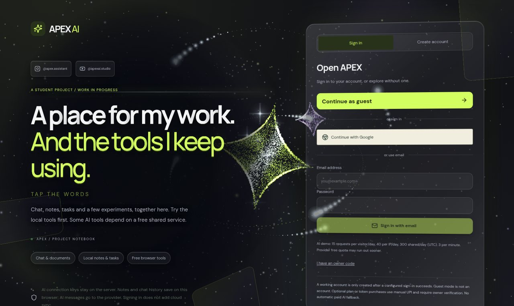
</p>

---

## Contents

- [Screenshots](#screenshots)
- [Features](#features)
- [Architecture](#architecture)
- [Tech stack](#tech-stack)
- [Getting started](#getting-started)
- [Testing](#testing)
- [Roadmap](#roadmap)
- [Honest limits](#honest-limits)
- [Project layout](#project-layout)

## Screenshots

All screenshots below were taken from the live app in a guest session.

### Chat with Vyom

<p align="center">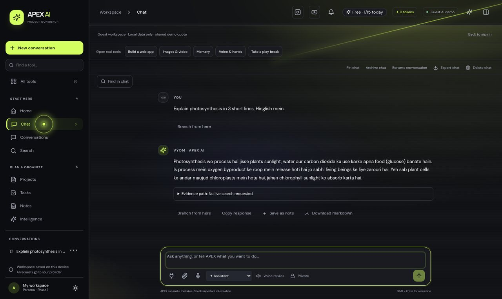</p>

Streaming answers, three modes (Assistant, Research, Reasoning), follow-up memory, attachments, voice notes, branching and export.

### Home and all tools

<table>
  <tr>
    <td width="50%">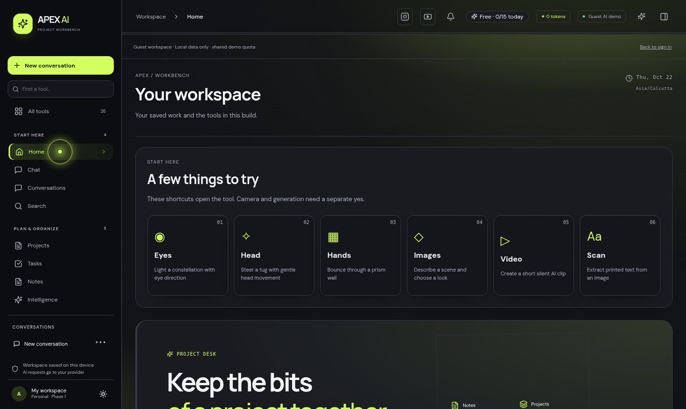</td>
    <td width="50%">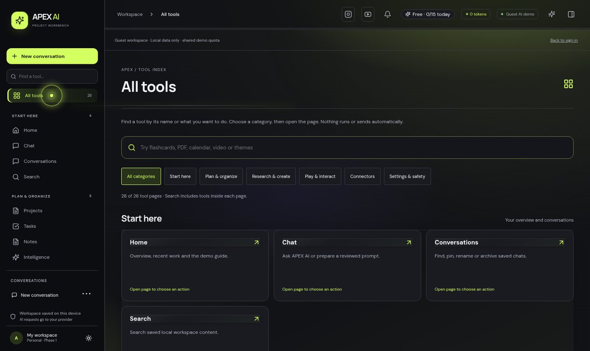</td>
  </tr>
  <tr>
    <td align="center"><sub>Home: shortcuts and project overview</sub></td>
    <td align="center"><sub>All tools: search and pin your favourites</sub></td>
  </tr>
</table>

### Tasks, code and plugins

<table>
  <tr>
    <td width="33%">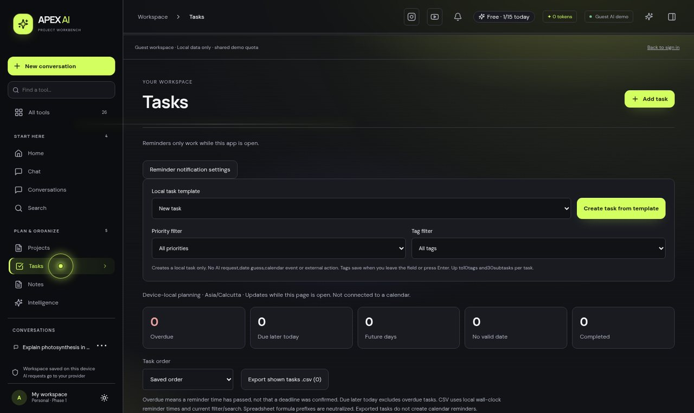</td>
    <td width="33%">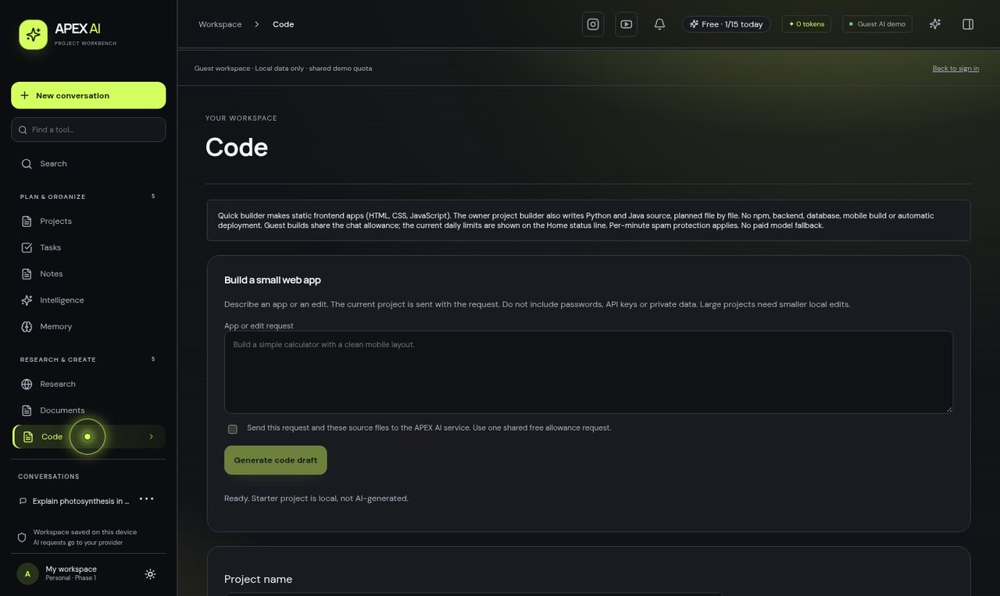</td>
    <td width="33%">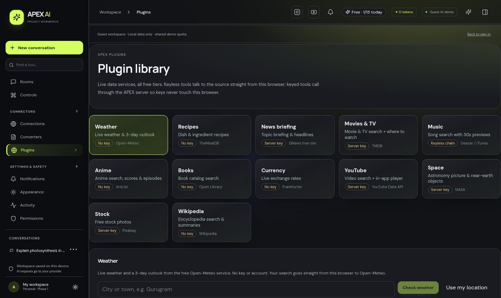</td>
  </tr>
  <tr>
    <td align="center"><sub>Tasks with calendar and templates</sub></td>
    <td align="center"><sub>Code space with Python in the browser</sub></td>
    <td align="center"><sub>Twelve free live-data plugins</sub></td>
  </tr>
</table>

### Games, themes and plans

<table>
  <tr>
    <td width="33%">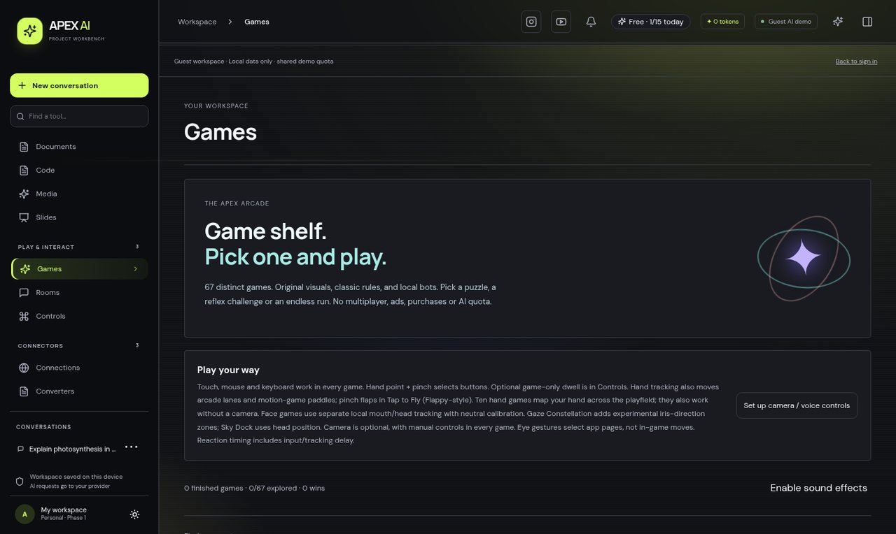</td>
    <td width="33%">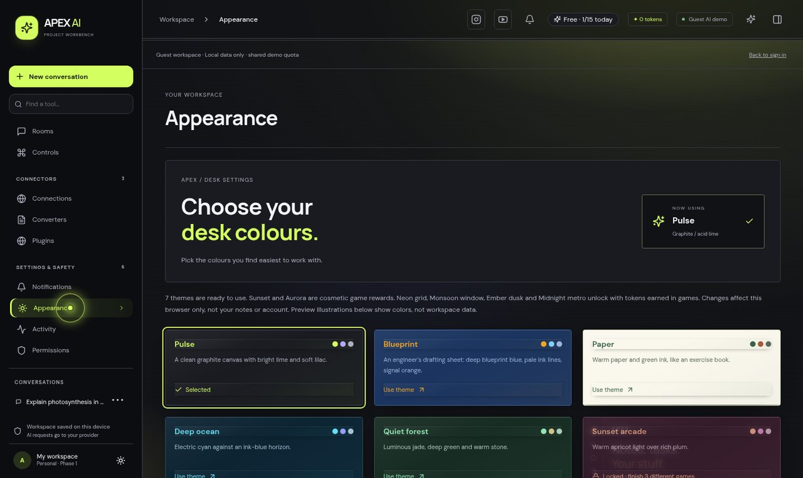</td>
    <td width="33%">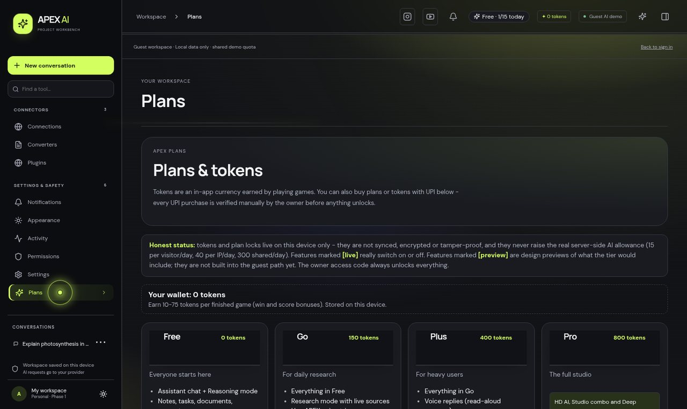</td>
  </tr>
  <tr>
    <td align="center"><sub>67 games with local bots</sub></td>
    <td align="center"><sub>24 themes</sub></td>
    <td align="center"><sub>Plans and the token counter</sub></td>
  </tr>
</table>

### Light theme and phone

<table>
  <tr>
    <td width="52%">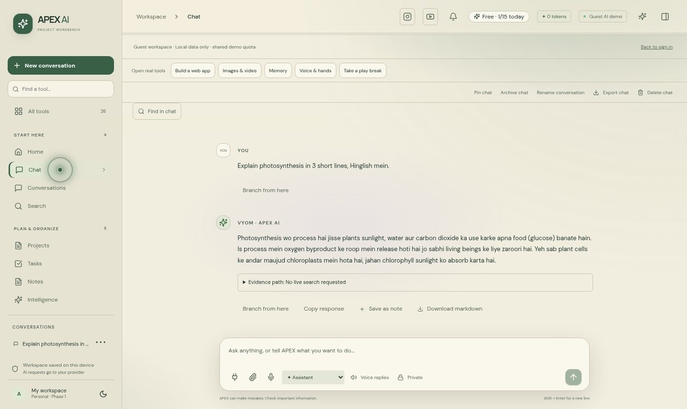</td>
    <td width="24%">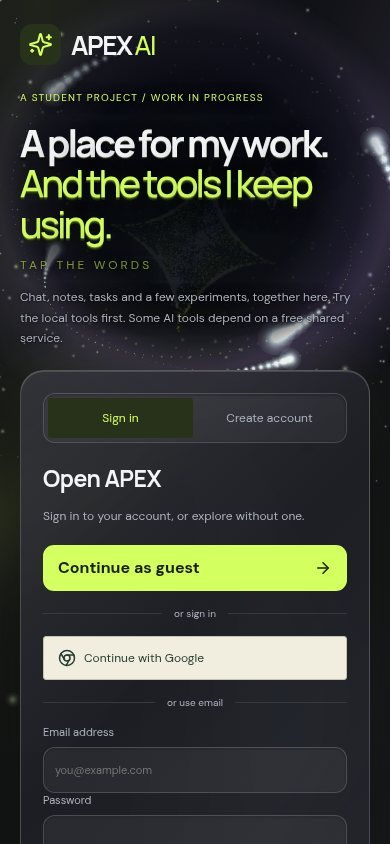</td>
    <td width="24%">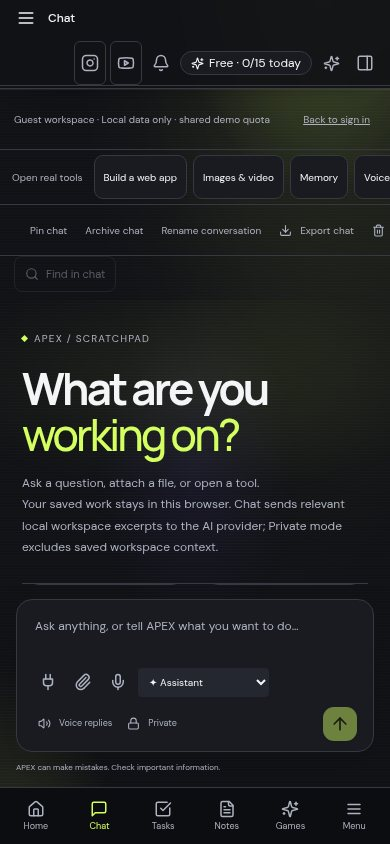</td>
  </tr>
  <tr>
    <td align="center"><sub>A light theme</sub></td>
    <td align="center" colspan="2"><sub>Installable on a phone as a web app</sub></td>
  </tr>
</table>

## Features

Everything in this section is built and working in the current version.

### Chat and voice
- Streaming answers in **Assistant**, **Research** (live web sources) and **Reasoning** modes
- English and Hinglish, with memory of earlier turns in the same chat
- Attach files and images, record **voice notes**, have answers **read aloud**
- Branch from any message, rename, pin, archive, search and export a chat
- Clean maths output: symbols and formulas are rendered, not shown as raw markup

### Notes, tasks and memory
- Note editor with import, study tools and PDF export
- Task board and calendar, templates, priorities, tags, reminders while the app is open
- A confirm dialog before a task is saved
- A memory page for facts you choose to keep

### Documents, research and code
- Read PDFs, scan and OCR images in the browser
- Web research with sources, and Wikipedia lookup
- Write and run **Python in the browser**, plus a step-by-step project builder

### Media and converters
- Free image generation, background removal and upscaling
- A video enhancer and slideshow maker that run on the device
- File and image converters that never upload the file

### Slides
- Builds a real `.pptx` presentation you can open in PowerPoint

### Plugins (free tiers)
Weather, recipes, news, movies and TV, music, anime, books, currency, YouTube, space photos and asteroids, stock photos, Wikipedia.

### Games
- **67 games** with local bots, including games you control with your **hand, face or eyes** through the camera
- A Rooms mode: share a code and play a live quiz together

### Look and feel
- **24 themes** (5 open to guests), light and dark
- A cinematic login with a 3D scene and liquid-glass panels on strong devices, and a lighter version on weaker ones
- Animations are on by default. A setting in *Appearance > Reading > Motion* lets you follow your device setting or reduce motion

### Accounts and plans
- Guest mode with a shared daily allowance, or sign in with Google or email
- Free, Go, Plus and Pro tiers, a token counter, and tokens earned by playing games. UPI purchases are checked by hand by the owner

### Privacy
- Chats, notes, tasks and memory stay in your browser. There is no cloud database of your content
- API keys live only in server settings and never reach the browser. The build fails if a known key pattern shows up in the public files

## Architecture

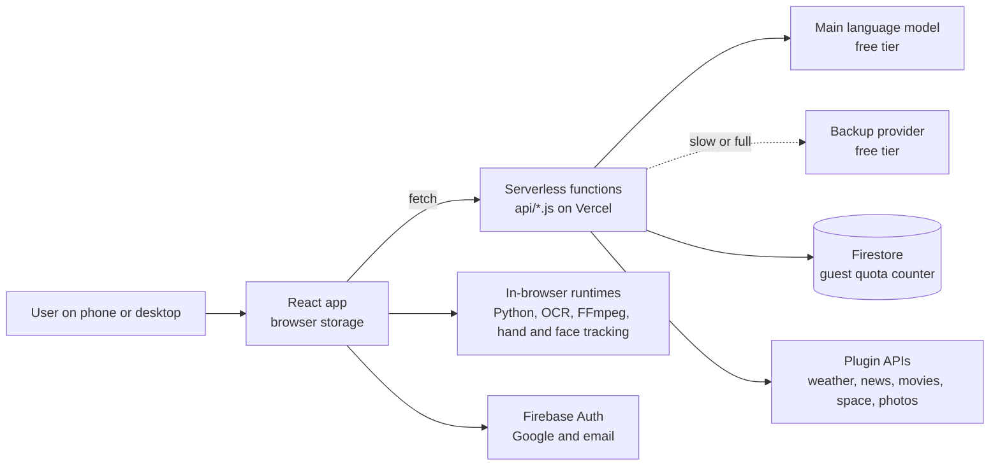

How it works:

1. **Local first.** The app keeps chats, notes and tasks in browser storage, separated into owner, guest and per-account workspaces.
2. **Thin server.** The `api/` functions only hold secrets and talk to outside services. They do not store user content.
3. **Fast fallback.** The chat function waits up to 5 seconds for the first word from the main model. If nothing arrives, or the provider errors, a backup provider answers.
4. **Fair use.** A Firestore transaction reserves one request from a shared daily allowance, with limits per visitor, per IP (hashed) and overall.
5. **Safe caching.** Only a repeated plain single question with nothing personal or live in it can be answered from cache.
6. **Adaptive visuals.** The app picks a 3D, light or static look from the device, so weaker phones stay smooth.

More detail is in [docs/REPORT.md](docs/REPORT.md).

## Tech stack

| Layer | Technology |
| --- | --- |
| Front end | React 19, Vite 6, plain CSS, canvas and WebGL scenes |
| Back end | Node.js serverless functions on Vercel (Mumbai region) |
| Auth and quota | Firebase Authentication, Firestore |
| AI | A free-tier hosted language model API with a second free provider as backup |
| In the browser | Pyodide (Python), Tesseract.js (OCR), FFmpeg (wasm), MediaPipe (hand, face and eye tracking), PDF.js, pdf-lib, pptxgenjs, a background-removal model |
| Tests | Node's built-in test runner |

## Getting started

You need Node.js 20 or newer.

```bash
git clone https://github.com/coderx-glitch/apex-ai.git
cd apex-ai
npm install
cp .env.example .env      # add your own keys, all are optional
npm run dev
```

The dev server serves the front end. To run the `api/` functions as well, use `npx vercel dev` with your own free account. Without keys the app still opens, and every tool that does not need a server key works. A feature whose key is missing says so on screen.

| Command | What it does |
| --- | --- |
| `npm run dev` | Start the front end with hot reload |
| `npm run build` | Production build, then scan the public files for secrets |
| `npm test` | Run the unit tests |
| `npm run check:public` | Run only the secret scan |

### Deploy

The project is ready for Vercel (see `vercel.json`). Add the variable names from `.env.example` in the project settings. Login and guest quota setup is written up in [setup/FIREBASE-SETUP.md](setup/FIREBASE-SETUP.md).

## Testing

- **Unit tests:** `npm test` runs 24 tests in 14 files: answer cache safety, first-word fallback, provider fallback, maths handling, date and clock helpers, research citation rules, document context, speaker selection and YouTube links. All pass.
- **Build check:** every build scans the public output for secrets.
- **Manual pass in headless Chrome before the event:** all 27 pages at desktop, tablet and phone widths with no overflow or script errors, guest login and re-login, chat, follow-up memory, Hinglish, the input limit, task save and reload, the plugin endpoints and text-to-speech.

## Roadmap

Not built yet. These show as **Coming next** in the app:

- [ ] Failure Forecast: warn when a task is likely to slip
- [ ] Time Travel: ask what you were working on 30 days ago
- [ ] Multi-agent tasks: planner, researcher and critic with a visible trace
- [ ] Cash Pro purchases (paused)
- [ ] Paid video generation (locked)

## Honest limits

- The AI runs on free tiers. Answers can be slow or briefly unavailable when a provider is busy. The backup covers most cases.
- Guests get a small shared allowance (15 requests per visitor per day).
- Reminders only fire while the app is open.
- Chats and notes do not sync between devices.
- The 3D login needs a reasonably strong device. Weaker phones get a simpler look on purpose.
- The NASA photo of the day is sometimes unavailable. The app then shows the last real photo it fetched with its date, or an error. It never shows a made-up image.
- I tested in headless Chrome. I did not run frame-rate tests on real phones, and the microphone, the "Hey APEX" voice trigger, Google sign-in with real accounts and image generation were not in the automated pass.
- The phone app is an installable web app (PWA). An Android APK that wraps the live site is on the Releases page. It is not on the Play Store, and its source is not in this repository.

## Project layout

```
api/        serverless endpoints (chat, connect, status, image, code, uploads ...)
lib/        shared logic for the server and the app (limits, security, caches, games ...)
src/        React app: screens, styles, 3D scenes
public/     static assets and the browser-side runtimes (OCR, FFmpeg, Pyodide, vision)
tests/      unit tests
setup/      setup notes and build-time checks
docs/       project report and README images
```

## Author

Built by **Aabhas Gupta**.
